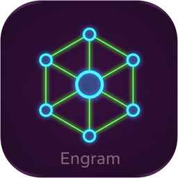
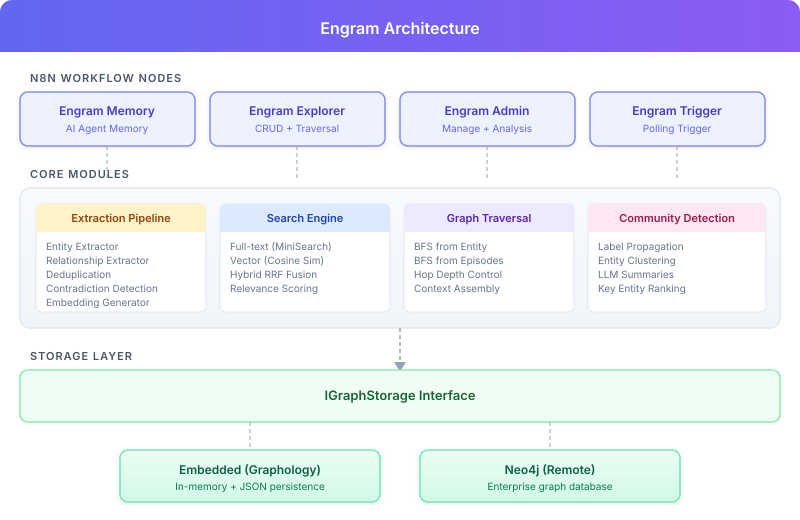
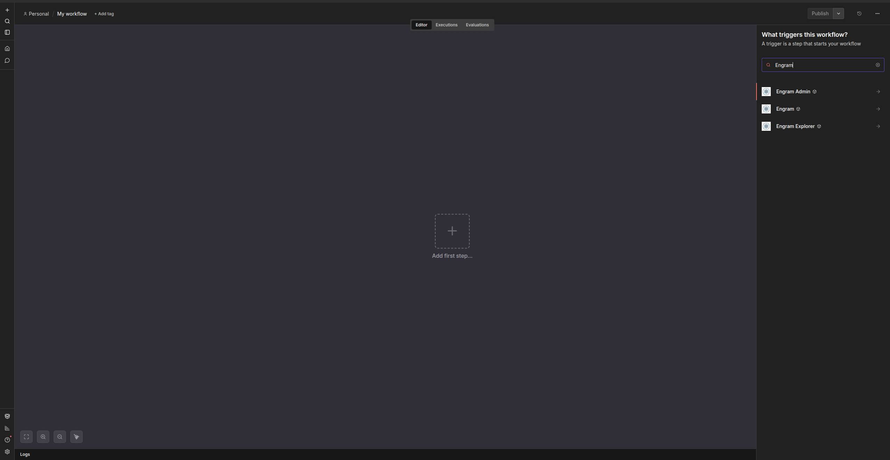
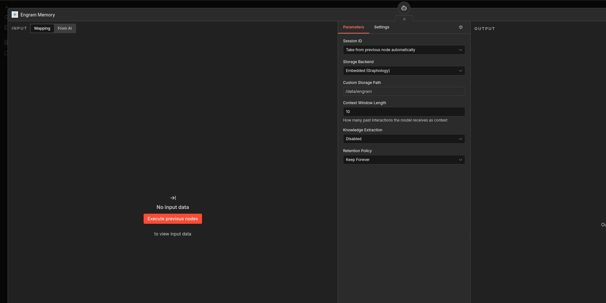
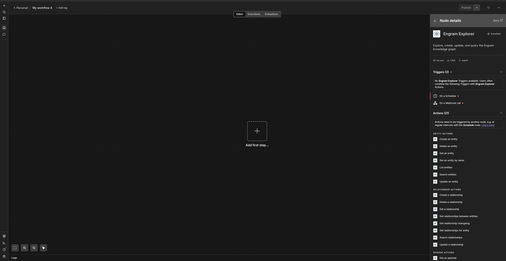
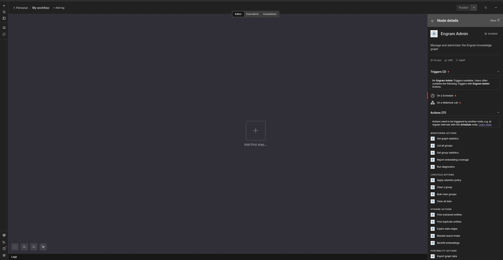
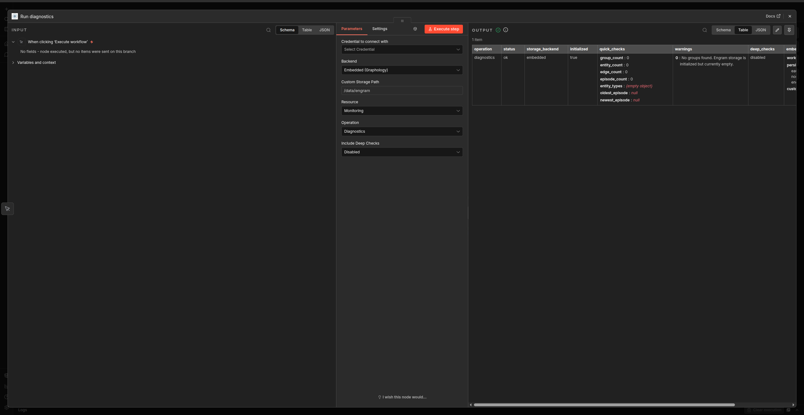
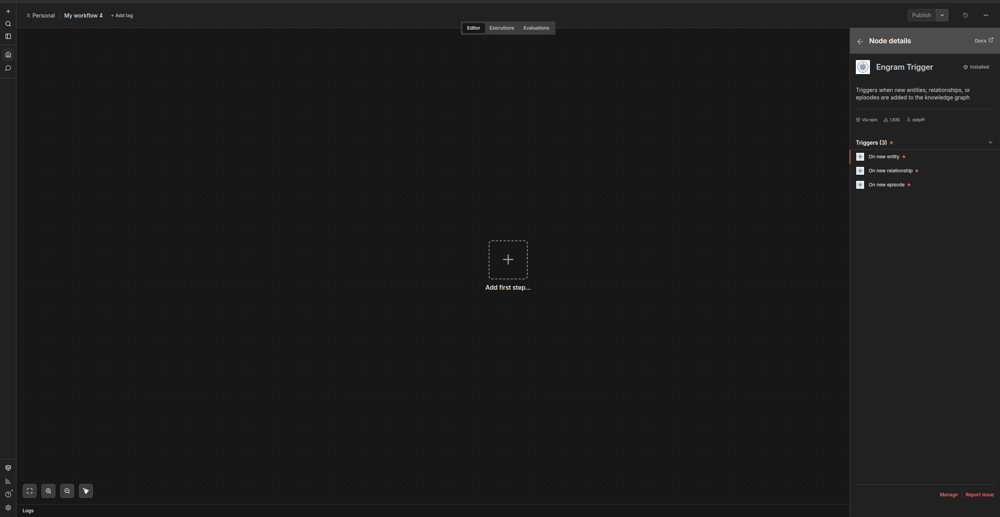

<p align="center">
  
</p>

<h1 align="center">n8n-nodes-engram</h1>

<p align="center">
  <strong>Knowledge graph memory for n8n AI agents</strong><br/>
  Persistent memory with entity extraction, temporal fact tracking, community detection, graph traversal, and hybrid search.
</p>

<p align="center">
  <a href="https://github.com/casistack/n8n-nodes-engram/actions/workflows/ci.yml">
    
  </a>
  <a href="https://www.npmjs.com/package/n8n-nodes-engram">
    
  </a>
  <a href="https://github.com/casistack/n8n-nodes-engram/blob/main/LICENSE">
    
  </a>
  
  
</p>

<p align="center">
  <a href="#installation">Installation</a> &middot;
  <a href="#upgrading-to-v072">Upgrade</a> &middot;
  <a href="#node-reference">Nodes</a> &middot;
  <a href="#storage-backends">Storage</a> &middot;
  <a href="#knowledge-extraction">Extraction</a> &middot;
  <a href="#search">Search</a> &middot;
  <a href="#data-storage--security">Security</a> &middot;
  <a href="#development">Development</a>
</p>

---

> **Note:** This is a community node. It is not officially supported by n8n. Use at your own discretion.

---

## Overview

Engram gives your n8n AI agents a **knowledge graph memory**. Instead of losing context between conversations, agents build and query a persistent graph of entities (people, organizations, concepts) and the relationships between them.

Every conversation is stored as an episode. An optional LLM extraction pipeline identifies entities and facts from dialogue, building a growing knowledge graph. When the agent receives a new message, Engram searches the graph for relevant facts and injects them as context&mdash;giving the agent long-term memory that goes beyond simple chat history.

### Highlights

| | Feature | Description |
| --- | --- | --- |
| **4** | n8n Nodes | Memory, Explorer, Admin, Trigger |
| **2** | Storage Backends | Embedded (zero-setup) or Neo4j (production) |
| **5** | Extraction Stages | Entity, dedup, relationships, contradictions, embeddings |
| **3** | Search Modes | Full-text, vector, hybrid RRF fusion |
| **350** | Tests | Unit + integration across 35 test suites |

---

## Architecture

<p align="center">
  
</p>

---

## Product Screenshots

Engram provides dedicated n8n nodes for AI memory, graph exploration, administration, diagnostics, and event-driven workflows.

| Installed nodes | AI Memory node |
| --- | --- |
|  |  |

| Explorer actions | Admin operations |
| --- | --- |
|  |  |

| Admin diagnostics output | Graph event trigger |
| --- | --- |
|  |  |

---

## Installation

### Via n8n Community Nodes

1. Go to **Settings > Community Nodes** in your n8n instance
2. Enter `n8n-nodes-engram`
3. Click **Install**

### Manual

```bash
cd ~/.n8n
npm install n8n-nodes-engram
```

---

## Upgrading to v0.7.2

Existing saved workflows retain their defaults and node versions. Installing this release does not enable automatic acceptance, change namespaces, rewrite historical memory or start a queue worker. New **Memory v3** and **Admin v3** nodes default to **Memory Behaviour > Existing / Custom**.

### Back Up and Activate

1. Take fresh, consistent workflow and backend backups before installing `n8n-nodes-engram@0.7.2`. Preserve exact namespaces, verified alias mappings, storage paths and producer workflow IDs. Restart n8n, refresh the editor and confirm the package version.
2. Start with an inactive copy of one direct-conversation workflow and a separate restored store. Upgrade only the selected Memory/Admin nodes to **v3**. Preserve the current extraction route, model and provider-default temperature setting.
3. In **Admin > Automatic Memory > Create Verified Actor Binding**, select the exact memory namespace and producer workflow ID. Bind a trusted application's stable issuer/actor reference to an **existing, explicitly accepted subject UUID**. Supply the operator and review reason. A name, phone number, session key or model confidence alone does not create this binding. Reassignment and revocation require the current binding revision.
4. Select a profile deliberately. **Conservative Automatic** accepts supported source-grounded preferences; **Explicit Requests Only** additionally requires trusted save intent or an unquoted leading `Remember this:`; **Review First** proposes supported preferences. Use **Preview Memory Policy** to inspect the versioned effective policy, configured limits and identity readiness. Worker readiness is a separate check.
5. On Memory v3, retain **Bounded** resolution, enable knowledge extraction and **Final Turns**, persist human episodes, and disable extraction from AI/system/tool content. Map the verified actor issuer/reference and a stable **Current Turn ID** from trusted application input. Keep tool audits separate. Extraction credentials/model remain required configuration, although this first profile implementation uses deterministic preference parsing rather than model requests.
6. Supply the complete **Raw Current Human Content**. If agent input adds a display label, explicitly attest **Application-Owned Display Wrapper** and provide exact UTF-16 human-region offsets. This attestation is only for application display metadata; never use it to hide quotes, reports, conditions or other human context. No arbitrary label stripping occurs.

### Supported Automatic Memory

Profile version 1 supports complete literal first-person preferences such as `I prefer concise explanations.`, `I like bullet points.`, `I do not like long explanations.` when the value belongs to the supported language, explanation, presentation or format vocabulary. Supported negative preferences retain their polarity. Ambiguous, quoted, hypothetical, sensitive and unsupported statements remain in the episode history without being promoted to accepted facts. Complex preferences, nickname identity merging and dated commitments are outside this profile version. No **Personal Assistant** profile is offered yet.

Exact repeated claims reuse the logical fact; a conflicting supported claim requires review. Rejected/manual decisions remain protected. Claim receipts distinguish accepted, proposed, rejected, deferred, unchanged and not-selected results, with persistence and mutation state. Source-episode acceptance is separate from fact acceptance. New budget diagnostics use a separate versioned `budget` field; the existing error categories remain unchanged.

Current personalization suppresses revoked bindings, unsupported evidence and unresolved opposite claims. Historical modes may return intact source-grounded preference records with an explicit historical qualification: their recorded review state does not establish current identity or validity. As-of retrieval excludes new claims recorded after the requested date. Literal value nodes are never presented independently as personal facts.

For an acknowledgement based on actual saving, put **Admin > Automatic Memory > Capture Human Memory** before the agent. Pass its **sourceId** into Memory v3's **Captured Human Source ID**, using the same backend, exact namespace, actor, turn ID, policy and formatted input. The current source is excluded from history, and the subsequent writer saves the final assistant/audits without saving or extracting the human turn again. Only `facts_accepted` confirms accepted graph knowledge; `review_required`, `not_saved`, `queued` and `unconfirmed` do not. A synchronous retry with a saved source but no recoverable receipt remains unconfirmed. An ordinary agent response generated before memory saving must not promise durable acceptance.

Budget/execution settings are separate from acceptance. The deadline is one extraction work budget, not memory expiry or the whole workflow timeout. Increasing it does not broaden accepted evidence. Durable mode still requires an explicitly deployed matching **Admin v3** worker, route and profile; queued work is not already indexed. Extraction retries never resend an external chat message.

### Verify and Roll Back

Before expanding rollout, verify normal and tool-assisted writes, a supported preference without a save command, a negative/uncertain preference, duplicate turns, and a temporary question. Check accepted graph records and provenance, then verify graph-only recall on the separate restored store with recent conversation excluded. Test historical recall separately. Review active and passive group writers independently.

**Recovery boundary:** once new profiles write bindings, envelopes, claims or role ownership, use consistent backend-native snapshots for recovery: the complete embedded graph file, or a Neo4j database backup. Preserve the original logical store mapping. Generic graph import and queue-aware JSON import deliberately reject restoration of new privileged bindings/ownership into a fresh store; a JSON export alone is not a supported recovery backup for these profiles. Retain queue-aware exports as additional inspection evidence when jobs exist.

For rollback, keep this binary and restore **Existing / Custom** writer settings while its readers continue validating new claims. Old-package downgrade and mixed-version writers/workers are unsupported for new-profile stores. Keep newly appended conversations; never overwrite them with an older snapshot. No reset, purge, bulk re-extraction or automatic legacy repair is part of this upgrade.

---

## Upgrading to v0.7.1

This patch fixes JSON-mode requests in bounded identity matching. It explicitly requests a valid JSON object and checks the trusted instruction before sending bounded extraction requests. Existing legacy extraction behavior and saved workflow defaults remain unchanged. No model, temperature or governance change is needed.

1. Take fresh, consistent backups of your workflows and Engram stores. **Embedded:** preserve the original producer graph file and storage directory. **Neo4j:** use your normal consistent database backup. Keep existing namespace keys and alias mappings.
2. Install `n8n-nodes-engram@0.7.1`, restart n8n, refresh the editor and confirm the installed version. Keep the existing Memory v2 bounded/quality/temperature settings. Node.js 20 or newer remains required. No schema migration, memory reset, purge, bulk re-extraction or queue activation is needed.
3. Start with one conversation workflow. Test normal and tool-assisted turns, a durable preference, a temporary question and historical recall. Confirm explicit extraction success or documented deferral and inspect actual graph facts; overall workflow success alone is insufficient. Expand other namespaces only after this canary passes.

Known JSON-instruction errors retain `kind=invalid_request` with fixed `reason=json_mode_instruction_missing` and `parameter=messages`. Deterministic HTTP 400 or authentication failures stop further equivalent comparisons in the extraction. Conversations remain saved while failed staged graph changes are discarded. No raw provider body is included in these diagnostics.

For rollback, preserve legitimate messages written after the backup and follow the queue-aware backup/downgrade restrictions below when jobs exist. Prefer restoring the previous workflow settings while retaining current memory. Never overwrite newer conversations with an old snapshot as routine rollback. This patch does not repair old extracted facts or reclassify historical episodes. The [v0.7.0 controls and worker setup](#upgrading-to-v070) remain opt-in.

---

## Upgrading to v0.7.0

For bounded-mode installations, use v0.7.1 or newer for the JSON-mode comparison fix.

These Memory v2 controls are optional. Existing workflows keep **Entity Resolution > Legacy**, **Knowledge Selection > Legacy**, **Extraction Execution > Synchronous** and **Graph Context Policy > Legacy**. Installing a newer package does not enable them or rewrite existing knowledge.

### Back Up and Install v0.7.0

1. Back up current workflows and n8n configuration. Preserve exact namespace keys and any existing alias mapping.
2. **Embedded:** pause writers and preserve each producer workflow's graph file, storage directory and workflow-to-file mapping. Use a separate restored store for upgrade trials. Once durable work exists, use **Extraction Queue > Export Queue Backup** for portable queue-aware recovery.
3. **Neo4j:** take a consistent database backup using your normal recovery procedure. Retain the same database and namespace identities. Graph writers coordinate through a shared store lock; validate concurrent write throughput during rollout.
4. Install `n8n-nodes-engram@0.7.0`, restart n8n, refresh the editor and confirm the installed version. Node.js 20 or newer is required. Existing v2 stores load without a bulk migration or re-extraction; earlier provenance/schema upgrades remain separate.
5. Run **Engram Admin > Monitoring > Diagnostics**. Saved Memory v1 nodes remain v1; upgrade selected nodes explicitly to **Memory v2** on an inactive workflow copy before enabling the new controls. Check that the copy points to the intended restored store.

### Activate Bounded Extraction First

Back up current workflows and both the graph and conversation records before changing settings. Preserve the exact namespace, including whitespace, and the existing embedded workflow-to-file mapping or Neo4j database. Begin with one conversation workflow and keep the current model, session identity and conversation window.

Select **Entity Resolution > Bounded** and **Message Write Policy > Final Turns**. Keep eligible human/final-assistant sources stored; system/tool extraction is unsupported in this mode. Exact names and explicitly verified aliases resolve before model comparisons. Defaults limit each extraction to an eight-candidate shortlist, 16 fuzzy comparisons, 32 model/embedding requests and a 30-second shared deadline. Identity ambiguity, pruned candidates and exhausted budgets remain proposed or deferred; they are not permission to merge existing identities. Legacy contradiction expiry and automatic summary updates are not performed by the bounded path.

Select **Knowledge Selection > Durable and Temporal** to keep temporary requests in conversation history without automatically accepting them as durable facts. Automatic acceptance requires accepted human provenance and complete, literal assertion evidence. Paraphrases, quotations, hypothetical or qualified statements and uncertain identities require review. This conservative policy can produce more proposed records. It does not reclassify, re-extract or delete previously stored facts. **Source Timezone** must be an explicit IANA zone such as `Europe/London`; omit it when unknown. Calendar-day resolution supports today/tomorrow/yesterday and a single explicit date. Other relative expressions remain uncertain.

**Graph Context Policy > Governed Current** reconciles search/traversal duplicates by relationship UUID, omits ungrounded entity summaries and excludes unresolved or out-of-interval plans from current context. **Governed Historical** retains historical evidence with source attribution; map historical intent explicitly in the workflow. **Governed As Of** requires an ISO timestamp with `Z` or a numeric offset and tests event-interval relevance, not what the system knew at that time. Separate **Durable Fact Token Allowance** (4096) and **Historical Evidence Token Allowance** (2048) stay within the overall graph context token cap; the recent-message window remains independent. A zero allowance disables that evidence category. Governed search and traversal share a 512-source-reference hydration allowance; candidates whose complete provenance does not fit are deferred, with `source_reference_deferred` and truncation diagnostics. Existing accepted legacy records are not automatically corrected. Genuine human JSON and quoted conversation remain in the episode ledger.

Inspect save diagnostics for per-stage elapsed time, model-call counts, available token usage, candidate/deferral counts and storage timing. Unavailable provider/backend measurements are `null`; overlapping stage/request/storage times must not be added together. Agree latency targets from your own normal and tool-assisted workloads before expanding the rollout.

### Activate a Durable Extraction Worker

Durable Queue removes model extraction from the chat save path by persisting the episode and its extraction job together. Graph facts become available only after a worker completes. It requires persistent storage, bounded resolution, Final Turns and **Retention Policy > Keep Forever**; unsupported combinations fail before the write. Use stable per-turn message/idempotency keys for retries.

1. Create a separate workflow with **Schedule Trigger > Engram Admin v2 > Extraction Queue > Process Jobs**. Start with **Worker Batch Size > 1**; each execution processes at most ten jobs sequentially. No worker runs automatically merely because the package is installed.
2. Configure the same backend and exact **Queue Group ID** as Memory. For embedded storage, set **Memory Workflow ID** to the original producer workflow ID and use the same custom storage directory. The worker's own workflow ID is not the producer's store. The existing producer file must be present. For Neo4j, use the same database and appropriate credentials.
3. Match the producer's extraction credential endpoint, model, temperature mode/value, entity types, thresholds, embedding configuration and all bounded/quality settings. Set the same nonsecret **Extraction Route ID** on producer and worker. API keys are not stored in jobs; credential rotation can retain the binding when these settings are unchanged. Route URLs containing credentials, query strings or fragments are rejected.
4. Activate the scheduled worker, then select **Extraction Execution > Durable Queue** on the producer. Inspect `delivery.status=queued`, job IDs, enqueue timing and `graph_fresh=false`; this is not a successful extraction result. Use **Extraction Queue > Status** for pending/failed counts, oldest pending time and bounded job summaries, then inspect worker outcomes and actual graph facts.
5. Verify an ordinary turn, a real tool-assisted turn, a durable preference, older-fact recall and an explicit historical query. Confirm the final pair is saved once, audits remain outside conversational context, original records retain their identity and the queue drains. Only then activate additional namespaces. Evaluate passive ingestion separately.

Jobs use fenced leases, bounded retry/backoff and atomic graph/completion writes. Restarts can recover work; retries do not resend chat messages. Configuration mismatch leaves work unclaimed. Use **Rebind Job** with an operator and reason only after reviewing corrected settings; this preserves the source/job identity and clears stale staged work. Pause, resume, retry and cancel are explicit reviewed operations. Capacity or durable-storage failures can reject the conversation write; monitor workflow errors rather than assuming every queued save is fail-soft. Snapshot preparation is capped at 100,000 records/100 MiB; source, request, response and staged-plan byte limits can defer oversized work without truncating original messages.

### Backups, Historical Artifacts and Rollback

Use **Extraction Queue > Export Queue Backup** to preserve jobs, ownership and completion markers along with graph/episode records. A generic graph export alone is not the queue recovery procedure. Imports verify checksums, namespace/endpoints and collisions; incomplete legacy source/chain references are retained with warnings. Imported active jobs are paused pending configuration review. Creating a fresh embedded import destination requires explicit review and a custom directory. Never import over newer live conversations.

The historical-artifact inspection and dry-run steps below still apply. This feature does not reinterpret historical records already labelled as genuine conversation, automatically delete extracted facts or provide a record-specific correction migration.

For rollback, first stop producers and workers and take a fresh queue-aware backup. Prefer restoring the previous policy settings on the new package. Before using an older binary, complete or explicitly cancel outstanding jobs and verify no worker remains active. Older binaries do not enforce queue ownership, leases or disk-sync protections; do not run old and new writers concurrently against a queue-bearing store. Keep the queue-aware backup and all new legitimate records. If an older package cannot safely read the retained operational metadata, use a separately reviewed recovery/export procedure; never overwrite live history with an old snapshot as routine rollback. Existing no-queue embedded stores retain their prior disk-sync behavior. Neo4j graph writers coordinate through a shared store lock to protect atomic extraction commits; measure concurrent write throughput before expanding a busy deployment.

---

## Upgrading to v0.6.0

**Installing this release makes the controls available; it does not automatically activate history filtering or final-turn writes.** Existing saved settings retain temperature `0`, History Filter `Off`, Message Write Policy `Legacy`, and Store Tool Audit `Disabled`. Saved Memory v1 nodes remain v1 until explicitly upgraded. The temperature control is available in both v1 and v2; the history/write/query controls require Memory v2.

### Back Up and Install

1. Back up your workflows and n8n instance configuration using your normal recovery procedure. Create current Engram exports and backend backups before changing package or node settings.
2. **Embedded:** preserve each workflow's graph file while writes are paused, or take a consistent Engram export. Keep the original storage directory, workflow-to-file mapping, and session/group keys. A copied workflow can have a different default storage filename; validate against a separately restored test copy rather than accidentally testing a new empty graph.
3. **Neo4j:** take a database backup or consistent export using your normal Neo4j recovery procedure. Keep the same database, credentials, and session/group keys for the existing deployment.
4. Upgrade the existing community-node installation to `n8n-nodes-engram@0.6.0`, restart n8n, refresh the editor, and confirm the installed version. Node.js 20 or newer is required by the package.
5. For stores already running `0.5.1`, this release requires **no storage schema migration** on either backend. Run **Engram Admin > Monitoring > Diagnostics** to confirm storage health. If upgrading from `0.4.x` or earlier, complete the existing provenance/schema migration instructions separately.

### Activate Deliberately, One Memory Workflow at a Time

Start with one backed-up direct-conversation workflow, then validate before updating the remaining Memory nodes. If it still uses Memory v1, use n8n's node upgrade action in an inactive workflow copy to adopt **Memory v2**. Preserve its intended storage and canonical session key; do not replace session keys or use display-name changes as an identity migration.

| Setting | Initial activation |
| --- | --- |
| Extraction Temperature Mode | Select **Provider Default** when the extraction model rejects temperature `0`; this truly omits the request field. Otherwise retain a mode supported by that model. |
| History Filter | Select **Provenance** to exclude known tool-output, monitor-summary, and audit episodes from context. |
| Message Write Policy | Select **Final Turns** to apply storage/extraction controls to both normal saves and native bulk tool-assisted saves. |
| Store Tool Audit | Keep **Disabled** initially. Enable only if audit retention is needed; retained audits stay outside conversation context under Final Turns. |
| Current Human Query | Map to the same current-human-message expression used by the agent prompt. The default accepts string `chatInput`, then string `input`; a different webhook shape needs an explicit mapping. |
| Store Human / AI Episodes | Review the intended retention; both default to Enabled in v2. |
| Extract from Human / AI / System and Tool Content | Human extraction defaults Enabled; AI and System/Tool extraction default Disabled. Review these when upgrading a v1 node. |
| Human Episode Kind | Keep **Active Human** for direct conversations; use **Passive Human** for observed/curated human ingestion. |
| Source Message ID / Idempotency Key | Use a stable **per-message/per-turn** identity for retry deduplication. A static session key or phone number is not a turn identity and can collapse distinct messages. |

The context window counts messages/episodes, not user turns or days. With filtering enabled, older eligible messages refill that window within **Maximum History Scan** (default 1000, maximum 10000). Load diagnostics distinguish snapshot overflow from scan-budget truncation. n8n subnode expressions can have different item-resolution behavior from regular nodes; validate mappings for independent conversations rather than assuming a batch resolves each item separately.

### Historical Artifacts: Inspect and Dry-Run First

This release does not delete historical episodes or graph facts. Provenance filtering cannot automatically prove that an unlabelled legacy JSON message is a tool artifact.

1. Use **Engram Explorer > Episode > List/Get** with the exact group, date, and provenance filters to inspect candidate records, their source identities, and `previous_episode_uuid` links. Preserve genuine human JSON, quoted content, and ambiguous messages.
2. For a bounded preview, use **Engram Admin > Lifecycle > Purge Episodes**, keep **Execution Mode > Dry Run**, and set the same exact group/provenance/date scope with a small **Maximum Episodes** limit. **Malformed Content Rule > Empty Assistant Output** can locate empty assistant records; inspect their neighboring episodes separately. **Content Contains** should use a distinctive reviewed marker, not generic JSON keys. Do not select **Delete** or confirm a purge as part of this upgrade. Dry-run results are preview candidates, not automatic approval for deletion or filtering.
3. There is no separate History Filter dry-run switch. Preview filtering in an **inactive workflow copy backed by a separate restored store**, compare its Memory load output before/after, and inspect `history.excluded_legacy`, `legacy_candidates`, `returned`, and `scan_truncated`.
4. If an exact legacy payload is confirmed to be an artifact, calculate its lowercase SHA256 from the **exact UTF-8 episode content**, including whitespace. Select **History Filter > Provenance and Reviewed Legacy** and add that digest to **Reviewed Legacy Content Hashes** (up to 100 comma-separated hashes). A matching hash still requires strict legacy role, adjacency, chain, and source checks. The neighboring empty assistant and reviewed payload are excluded only from context; original records and facts remain intact. Unapproved or ambiguous JSON stays visible.

### Verify Before Expanding the Rollout

- **Extraction:** inspect the Memory save/bulk-write `extraction` outcome and verify expected accepted entities/relationships in Explorer. A green overall chat execution or a valid empty extraction response alone does not prove fact creation.
- **Older recall:** query a known older accepted fact after its episode has fallen outside the recent-message window. Confirm the configured current query and relevant graph context, including any governance filters.
- **Tool-assisted conversation:** exercise a real tool, confirm the real human/final-assistant messages are retained, and verify tool results are not new human sources. Inspect bulk write and extraction diagnostics.
- **Filtered history:** confirm useful messages refill the window, reviewed exclusions match expectations, genuine JSON/quotes remain, and scan truncation is understood. Re-run one explicit turn identity to check retry behavior without reusing that identity for new turns.

After these checks pass, apply the intended controls to the remaining Memory nodes in stages. Extraction and persistence are not a transactional exactly-once pipeline: retrying an already-stored source does not automatically recover extraction interrupted after persistence. Storage-disabled extraction has no durable retry ledger.

### Rollback

Keep the pre-upgrade workflows, exports, and backend backups unchanged until rollout validation finishes. To roll back, pause writes, restore the saved workflow configuration, reinstall `n8n-nodes-engram@0.5.1` through the same installation method, and restart n8n. This returns the prior behavior, including its extraction-model limitations.

No store restore is required merely to undo a non-destructive history filter. However, if **Store Tool Audit** was enabled, `0.5.1` does not implement the new audit-context exclusion and may replay those new records. Review that history before downgrading; keeping `0.6.0` with the intended controls or using a separately restored pre-upgrade store may be preferable. Turning filtering off does not delete audit records.

If a store restore is necessary, use the backed-up embedded file/Engram export or your Neo4j recovery procedure while writes are paused. Reconcile messages created since the backup before replacing live data; restoring an older snapshot can discard newer conversations. Never wipe groups, trim/change session keys, or delete graph facts as an automatic rollback step.

---

## Upgrading from v0.4.x

Version `0.5.0` adds episode provenance and governance fields. Storage migration and n8n node-version upgrades are separate steps.

1. Create a current Engram export or storage/database backup before upgrading the package.
2. Upgrade `n8n-nodes-engram`, restart n8n, and confirm the installed package version.
3. Complete the storage-backend steps below.
4. Run **Engram Admin > Monitoring > Diagnostics** and confirm that no storage migration remains.
5. Upgrade selected Engram Memory nodes to v2 in an inactive workflow copy before changing production workflows.

### Embedded Storage

No migration node is required. On first initialization after the package upgrade, Engram:

- migrates the embedded graph before opening it;
- creates and verifies a backup ending in `.pre-schema-2.0.backup.json`;
- replaces the graph atomically; and
- leaves the original graph unchanged if backup verification or migration fails.

After initialization, use **Engram Admin > Monitoring > Diagnostics** to verify the migration and backup status.

### Neo4j Storage

Neo4j migration is intentionally operator-controlled so Engram does not perform an unbounded database rewrite during startup.

1. Add an **Engram Admin** node configured with the same Neo4j credentials as the production memory workflow.
2. Select **Lifecycle > Migrate Storage Schema** and run **Dry Run**.
3. Review the matched legacy episode count.
4. Select **Migrate**, set **Confirm Migration** to **Confirmed**, and execute a bounded batch.
5. Repeat until `remaining_count` is `0`, then confirm the result with **Monitoring > Diagnostics**.

The Neo4j migration is additive and only fills missing governance fields with conservative defaults.

### Engram Memory v2

Installing `0.5.0` does not silently change saved Engram Memory nodes. Existing v1 nodes retain their previous behavior until explicitly upgraded through n8n's node upgrade action.

- Keep **Human Episode Kind > Active Human** for direct agent conversations.
- Select **Passive Human** for observed or curated human messages stored by passive ingestion workflows.
- Validate the upgraded node in an inactive workflow copy before replacing the production workflow.

---

## Quick Start

### Minimal Setup (No LLM Required)

1. Add an **Engram Memory** node to your AI Agent workflow
2. Connect it to the agent's Memory input
3. Set **Storage Backend** to `Embedded (Graphology)`
4. Leave **Knowledge Extraction** as `Disabled`

Your agent now has persistent conversation history stored as episodic memory.

### Full Setup (With Extraction)

1. Create an **Engram Extraction LLM** credential:
   - **Base URL**: OpenAI-compatible endpoint (e.g. `https://api.openai.com/v1`)
   - **API Key**: Your API key
2. Add an **Engram Memory** node, enable **Knowledge Extraction**
3. Select an extraction model (e.g. `gpt-4o-mini`)
4. Optionally enable **Semantic Search (Embeddings)** with an embedding model
5. Optionally enable **Graph Traversal (BFS)** for context enrichment

The extraction pipeline automatically identifies entities and relationships from conversations and builds a queryable knowledge graph.

---

## Node Reference

### Engram Memory

> AI Memory node&mdash;connects to the AI Agent memory input.

On each conversation turn, Engram Memory:

- **Loads** relevant facts from the knowledge graph as system context, plus recent chat history
- **Saves** messages as episodes, optionally running the full extraction pipeline

| Setting | Description | Default |
| --- | --- | --- |
| Storage Backend | Embedded (Graphology) or Neo4j | Embedded |
| Knowledge Extraction | LLM-powered entity extraction | Disabled |
| Extraction Temperature Mode | Legacy (0), Provider Default (omit), or Custom | Legacy (0) |
| Store Human Episodes | Persist human messages as episodes (v2) | Enabled |
| Human Episode Kind | Classify human input as active or passive provenance (v2) | Active Human |
| Store AI Episodes | Persist assistant replies as episodes (v2) | Enabled |
| Extract from Human Messages | Allow human content to produce facts (v2) | Enabled |
| Extract from AI Messages | Allow assistant content to produce facts (v2) | Disabled |
| Semantic Search | Vector embeddings for hybrid search | Disabled |
| Graph Traversal | BFS enrichment from matched entities | Disabled |
| Context Window | Recent messages/episodes to include | 10 |
| Max Facts per Query | Facts injected as context | 10 |
| Min Relevance Score | Threshold for inclusion (0&ndash;1) | 0.5 |
| Retention Policy | Episode lifecycle management | Forever |

Existing saved Engram Memory nodes retain their original node version and behavior when the package is upgraded. Use n8n's node upgrade action on a workflow copy to adopt v2 controls. Passive ingestion workflows should select **Human Episode Kind > Passive Human**, while direct agent conversations should keep the default **Active Human** classification.

### History Filtering and Final-Turn Writes (Memory v2)

These controls are opt-in. Existing saved settings keep **History Filter > Off** and **Message Write Policy > Legacy**. Upgrade a v1 Memory node through n8n's node upgrade action on a workflow copy before adopting the v2 controls. Session keys and existing episodes are preserved.

- Select **History Filter > Provenance** to exclude tool-output, monitor-summary, and audit episodes from conversation context.
- Select **Provenance and Reviewed Legacy** to additionally exclude an exact reviewed legacy artifact pair: an empty assistant `[]` immediately chained to an unlabelled legacy human array of response/error objects. The human payload must match a configured **Reviewed Legacy Content Hash**, and source/chain checks must agree. Without that approval, ambiguous JSON remains. Genuine human JSON, quoted messages, and graph fact SystemMessages are retained.
- **Reviewed Legacy Content Hashes** accepts up to 100 comma-separated lowercase SHA256 hashes of exact UTF-8 episode content, including its whitespace. Review the original episodes before supplying hashes. Filtering changes only the context read; it does not delete records, rewrite chains, or remove graph facts.

The context window counts eligible messages. Engram captures one bounded recent-episode snapshot and scans it in local pages of 100, refilling from older eligible messages. **Maximum History Scan** defaults to 1000 and is capped at 10000; one extra prefetched episode supports boundary evidence and overflow detection. This is bounded snapshot prefetch with local paging, not backend cursor pagination. Load diagnostics show `fetched`, `examined`, `pages`, exclusion counts, and `returned`. `snapshot_overflow` means more history existed than the scan allowance; `scan_truncated` means that allowance prevented filling the window. No new appends are fetched during the scan.

Select **Message Write Policy > Final Turns** to apply the same storage, extraction, and provenance controls when n8n saves a normal turn or calls the native bulk-message tool-save path. Engram retains real human input and the final assistant reply after identified tool calls have closed. Native tool/function messages and intermediate assistant tool calls are classified distinctly and never become human input. **Store Tool Audit** optionally retains those messages as unverified tool-output episodes; they stay outside conversation context even with History Filter set to Off. Tool extraction remains a separate explicit control and is disabled by default.

Set a stable per-turn **Idempotency Key** or human **Source Message ID** to deduplicate retries across both write paths. Final-role keys are independent of intermediate tool count. Repeated identical turns without an explicit identity remain distinct. Existing stored sources are not re-extracted on an ordinary duplicate write; persistence followed by extraction is not a transactional exactly-once guarantee. If storage is disabled, extraction uses transient sources and has no durable retry ledger. Native bulk-save diagnostics report confirmed writes, duplicates, audits, skipped messages, and the extraction outcome.

### Current Query for Empty Memory Loads

Some n8n agent versions call memory loading with empty values. Configure **Current Human Query** to the same current-message expression used by the agent prompt. Its default reads string `chatInput`, then string `input`, and otherwise leaves the query empty. Explicit input passed by the agent takes precedence. Engram does not infer a current query from old history.

The expression is resolved in n8n's subnode item context when memory is supplied. Subnode expression behavior can differ from regular-node per-item evaluation; process independent conversations separately and validate mappings in your workflow. Load diagnostics expose `retrieval.query_source` (`input`, `configured`, or `none`), query availability, and the number of graph fact context messages without including query text. If no current query is available, history still loads but graph search is not attempted. Validate graph recall with a known older accepted fact beyond the recent-message window.

### Engram Explorer

> Regular node&mdash;CRUD operations on the knowledge graph.

| Resource | Operations |
| --- | --- |
| **Entity** | Create, Get, Get by Name, List, Search, Update, Delete |
| **Relationship** | Create, Get, Get Between, Get for Entity, Search, Review, Update, Delete, Get Changelog |
| **Episode** | Get, Get Recent, Get by Date Range, Get Count, List, Update, Delete |
| **Traversal** | BFS from Entity, BFS from Episodes |

### Engram Admin

> Regular node&mdash;administration and analysis.

| Resource | Operations |
| --- | --- |
| **Monitoring** | Stats, List Groups, Group Stats, Embedding Coverage, Diagnostics |
| **Lifecycle** | Apply Retention, Purge Episodes, Migrate Storage Schema, Clear Group, Bulk Clear Groups, Clear All |
| **Hygiene** | Orphaned Entities, Duplicate Entities, Expire Stale Edges, Rebuild Search Index, Backfill Embeddings |
| **Portability** | Export, Import |
| **Analysis** | Detect Communities |

### Engram Trigger

> Polling trigger&mdash;fires when new entities, relationships, or episodes appear in the graph.

### Operational Diagnostics

Engram Admin includes a read-only **Monitoring > Diagnostics** operation for production checks. By default it returns quick storage and graph counts only. Optional deep checks scan the full graph to report embedding coverage, expired/invalidated edges, dangling edges, and duplicate entity-name groups.

For embedded storage, diagnostics also report the most recent mutation's queue wait, file-lock wait, disk refresh, rollback export, graph mutation, snapshot write, rollback restore, total duration, and snapshot size. These timings help distinguish lock contention from large-snapshot persistence costs.

Use **Monitoring > Embedding Coverage** to check whether entities and facts have vectors before enabling hybrid search broadly. Use **Hygiene > Rebuild Search Index** to rebuild the embedded full-text index from stored graph data. Use **Hygiene > Backfill Embeddings** in dry-run mode first, then disable dry-run to fill missing embeddings with the configured embedding model.

Explorer entity and relationship searches can optionally return retrieval diagnostics. The aggregate trace shows active filters, bounded candidate scores and decisions, rejection reasons, and which complete items fit the context preview budget. Diagnostics are disabled by default.

### Import, Export, and Backups

Engram exports use graph format `2.0` and include count metadata and a SHA-256 checksum. Imports support **Dry Run** mode, optional maximum item limits, checksum verification before migration, migration reporting, and reference-integrity warnings before writing data. Existing `1.0` backups remain importable; episodes without provenance are classified as `legacy`, `unverified`, and `proposed` rather than being accepted automatically.

Embedded storage upgrades automatically before the graph is opened. Engram creates and verifies an owner-readable backup beside the storage file, writes the migrated graph with atomic replacement, and stops without changing the source if backup verification or migration fails. The backup name ends with `.pre-schema-2.0.backup.json`, and **Monitoring > Diagnostics** reports its path and verification state.

Neo4j remains available during an upgrade and does not perform an unbounded startup rewrite. Use **Lifecycle > Migrate Storage Schema** in **Dry Run** mode to inspect the remaining legacy episode count, then apply confirmed bounded batches until the remaining count reaches zero. The migration is additive: it only fills missing governance fields with conservative legacy defaults.

For a staged restore, first run the import in **Dry Run** mode and review the source/target versions, default counts, and warnings. Keep the original export unchanged, then perform the write import only after the report matches expectations. Export the restored graph again to create a checksummed `2.0` backup.

To remove historical monitor or tool pollution, use Explorer episode filters to inspect the affected source, kind, trust level, or date range. Admin **Lifecycle > Purge Episodes** can also match empty assistant output or a case-insensitive content fragment. Always run the bounded purge in dry-run mode and review the matched episodes before confirming deletion.

For production Neo4j deployments, see [`docs/production-neo4j.md`](docs/production-neo4j.md). Ready-to-import starter workflows are available in [`docs/workflows/`](docs/workflows/).

---

## Storage Backends

| | Embedded (Graphology) | Neo4j |
| --- | --- | --- |
| **Setup** | Zero configuration | Requires Neo4j instance |
| **Persistence** | JSON file on disk | Neo4j database |
| **Vector search** | Brute-force cosine similarity | Brute-force cosine similarity |
| **Best for** | Development, single-instance | Production, multi-instance |
| **Scaling** | Single n8n instance | Independent of n8n lifecycle |

Both backends implement the same `IGraphStorage` interface. All features work identically on either backend.

---

## Knowledge Extraction

When enabled, the extraction pipeline processes each conversation turn:

```text
User message + AI response
        |
   Entity Extractor ── identifies people, orgs, locations, concepts
        |
   Entity Deduplicator ── merges "Bob Smith" with "Bob"
        |
   Relationship Extractor ── extracts facts ("Alice works at Acme")
        |
   Contradiction Detector ── flags conflicting facts
        |
   Embedding Generator ── (optional) vectors for semantic search
```

**Supported providers**: Any OpenAI-compatible API&mdash;OpenAI, OpenRouter, Ollama, LM Studio, Together AI, and others.

**Configurable entity types**: `person`, `organization`, `location`, `concept`, `event`, or custom types.

Extracted entities and relationships include `attributes.engram_extraction` provenance metadata with source, extraction timestamp, confidence placeholder, review status, and related episode UUIDs where available.

### Extraction Model Compatibility

**Extraction Temperature Mode** applies to every extraction stage in Engram Memory v1 and v2:

- **Legacy (0)** sends temperature `0` and preserves existing workflow behavior.
- **Provider Default** omits the temperature field. Select this when your model rejects custom temperatures or requires its own default.
- **Custom** sends the **Extraction Temperature** value. Use a finite number supported by your provider and model; supported ranges vary.

Upgrading the package alone retains Legacy (0). To resolve an unsupported-temperature error, select Provider Default explicitly in the affected Memory node and validate the workflow before activating it. No storage migration or Memory node-version upgrade is required for these settings. Engram does not automatically change models or retry rejected requests with guessed settings. Extraction still uses Chat Completions JSON-object mode; confirm that your provider and model support it.

### Extraction Outcomes

In an execution, open the Engram Memory save output and inspect `extraction`. Conversation history saves before extraction, so an overall successful conversation can still have a failed extraction outcome.

| Status | Meaning |
| --- | --- |
| `disabled` | Knowledge extraction is disabled. |
| `skipped` | No eligible, nonempty source messages were selected. |
| `succeeded` | Attempted stages completed; finding zero entities is also successful. |
| `partial` | An optional stage failed, malformed records were excluded, or a required stage failed after some graph changes succeeded. |
| `failed` | A required stage failed before any graph changes succeeded, or extraction configuration is missing. |

Outcomes include duration, stage status, confirmed mutation counts, filtered/malformed record counts, and bounded error classifications such as `unsupported_parameter`, `authentication`, `rate_limit`, and `timeout`. Update counts include metadata-only updates; edge expirations are counted separately. Partial extraction does not roll back completed graph changes. Provider error bodies and message content are excluded from extraction error diagnostics; normal n8n conversation previews still contain message content.

Extraction outcomes belong to their execution's save output. Engram Admin storage diagnostics do not provide a persistent extraction event history. A failed history preview is reported separately from the completed save. The context window counts messages, not user turns or days; graph recall operates independently of that window.

---

## Search

| Mode | Description | Requirements |
| --- | --- | --- |
| **Full-text** | Keyword search on names, summaries, and facts | None |
| **Vector** | Cosine similarity on embedding vectors | Embeddings enabled |
| **Hybrid RRF** | Reciprocal Rank Fusion combining text + vector | Embeddings enabled |

Hybrid search automatically activates when both text and vector search are available.

All search operations support optional **temporal filters** (`valid_after`, `valid_before`, `created_after`, `created_before`) to scope results by time.

---

## Temporal Queries

Engram tracks when facts are valid (`valid_at`, `invalid_at`) and when they were superseded (`expired_at`). You can query the graph by time:

| Operation | Node | Description |
| --- | --- | --- |
| **Get by Date Range** | Explorer > Episode | Retrieve episodes within a time window by `reference_time` |
| **Get Changelog** | Explorer > Relationship | Get recently created, expired, or invalidated relationships since a given date |
| **Search with date filters** | Explorer > Entity/Relationship Search | Filter search results by `valid_after`, `valid_before`, or `created_after` |

Date parameters use ISO 8601 format (e.g. `2026-01-15T00:00:00.000Z`). The LLM agent can convert natural language like "last week" into concrete dates before calling these operations.

---

## Community Detection

Clusters related entities using **label propagation**. Communities are computed on demand via **Engram Admin > Detect Communities** and include member entities, key entities ranked by connectivity, and optional LLM-generated summaries.

---

## Graph Traversal

BFS (breadth-first search) walks the knowledge graph outward from seed entities, collecting connected entities and relationships within a configurable hop limit.

- **BFS from Entity**: Start from specific entity UUIDs
- **BFS from Episodes**: Start from entities referenced in recent episodes
- **Automatic enrichment**: When enabled on the Memory node, a shallow BFS (default: 1 hop) runs after each search to enrich agent context

---

## Data Storage & Security

Engram stores conversation data and extracted knowledge. You should understand where this data lives before deploying to production.

**Embedded backend:**

- Data is stored as a JSON file at `~/.n8n/storage/n8n-nodes-engram/{workflowId}-engram.json` by default
- You can override the default with **Custom Storage Path** when using embedded storage
- The file contains all entities, relationships, episodes, and embeddings in plain text
- A normal human-and-assistant turn is committed as one atomic episode batch, preserving episode order while avoiding duplicate snapshot writes
- Backups: copy the JSON file

**Neo4j backend:**

- Data is stored in your Neo4j database instance
- Engram does not manage Neo4j authentication, encryption, or access control&mdash;configure these in Neo4j directly
- Credentials (URI, username, password) are stored in n8n's encrypted credential store

**LLM API calls:**

- When extraction is enabled, conversation content is sent to the configured LLM provider for entity/relationship extraction
- Embedding generation sends entity names and facts to the configured embedding model
- No data is sent to any external service unless you explicitly enable extraction and configure an API credential

**General:**

- Engram does not phone home, collect telemetry, or make network calls beyond the LLM API you configure
- All data stays on your infrastructure
- Group IDs isolate data between different conversations/users

---

## Credentials

### Engram Extraction LLM

| Field | Description |
| --- | --- |
| Base URL | OpenAI-compatible API base URL |
| API Key | API key for the LLM provider |

Used for entity extraction, community summaries, and embedding generation.

### Engram Neo4j Connection

| Field | Description |
| --- | --- |
| URI | Neo4j connection URI (e.g. `bolt://localhost:7687`) |
| Username | Neo4j username |
| Password | Neo4j password |
| Database | Database name (default: `neo4j`) |

Required only with the Neo4j storage backend.

---

## Development

### Prerequisites

- Node.js >= 18.10
- npm

### Setup

```bash
git clone https://github.com/casistack/n8n-nodes-engram.git
cd n8n-nodes-engram
npm install
```

### Commands

| Command | Description |
| --- | --- |
| `npm run build` | TypeScript compilation + icon build |
| `npm run lint` | ESLint |
| `npm run format` | Prettier (write) |
| `npm run format:check` | Prettier (check) |
| `npm run type-check` | TypeScript type checking |
| `npm test` | Run all tests |
| `npm run test:coverage` | Coverage report |

### Git Hooks (Husky)

| Hook | Checks |
| --- | --- |
| `pre-commit` | ESLint, Prettier, TypeScript type-check |
| `pre-push` | Build, full test suite |

### CI/CD

- **Pull requests**: Lint, type-check, test across Node 18/20/22
- **Releases**: Automated npm publish on GitHub Release

---

## Support

If you find Engram useful, consider supporting the project:

<a href="https://www.buymeacoffee.com/cassistack" target="_blank">
  
</a>

---

## License

[AGPL-3.0](LICENSE)
